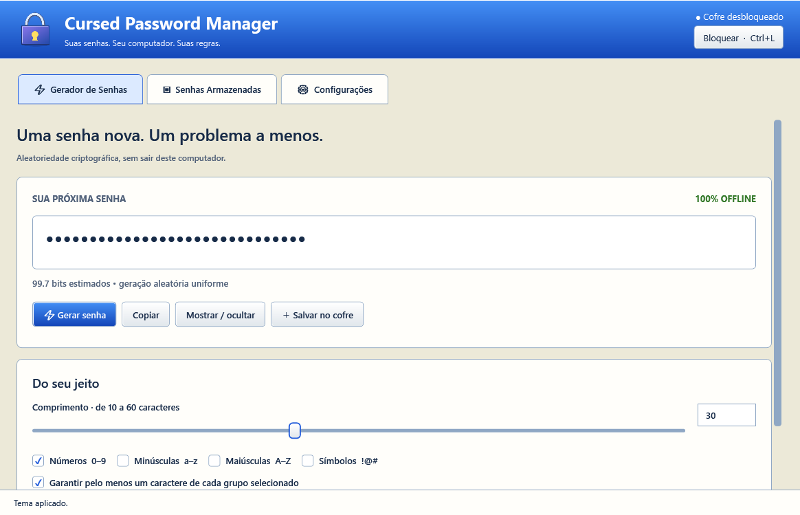
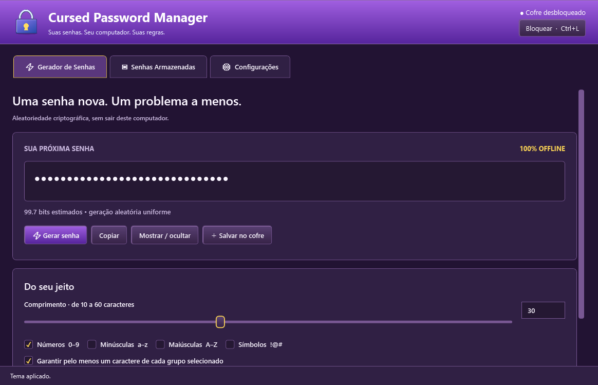
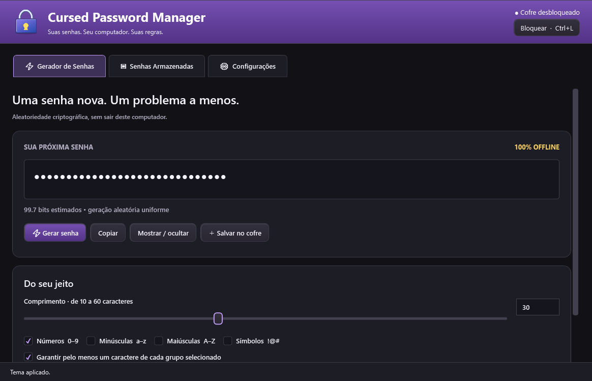

# Cursed Password Manager


**Developed by FlynnOfHearts**

Um gerenciador de senhas desktop para Windows, com a nostalgia do XP e um cofre criptografado totalmente offline. Sem conta online, navegador embutido, telemetria, servidor ou assinatura.

**Windows 10/11 · x64 · C# / .NET 10 · WPF · licença MIT**

## Comece aqui

1. Abra `CursedPasswordManager.exe` da distribuição Windows ou portátil.
2. Crie uma senha mestra com pelo menos 12 caracteres. Prefira uma frase longa, exclusiva e memorável.
3. Escolha as pastas principal e secundária; se possível, use outra unidade física para a segunda.
4. Guarde sua senha mestra em local seguro. **Não existe senha universal nem recuperação secreta.**
5. Gere senhas ou adicione suas contas em **Senhas Armazenadas**.

Fechar a janela mantém o programa na bandeja por padrão. Para encerrar, use **Sair** no menu do ícone próximo ao relógio. Esse comportamento pode ser alterado nas configurações. O cofre sempre inicia bloqueado.

## Funcionalidades

| Página | Recursos |
| --- | --- |
| Gerador de Senhas | 10–60 caracteres; padrão numérico com 30 dígitos; grupos combináveis; estimativa de entropia; copiar, revelar e salvar |
| Senhas Armazenadas | Adicionar, editar, excluir, pesquisar, ordenar, favoritar, organizar categorias, consultar/restaurar histórico e fazer auditoria offline |
| Configurações | Três temas, senha mestra, Windows Hello condicionado ao provedor, bloqueio, área de transferência, três cópias, recuperação, importação/exportação e bandeja |

Atalhos: **Ctrl+G** gera uma senha, **Ctrl+N** adiciona uma credencial e **Ctrl+L** bloqueia o cofre.

## Três temas, uma única interface

**Windows XP Classic** é o padrão da primeira execução. **Cursed XP** combina roxo, amarelo e relevos retrô. **Cursed Modern** usa grafite, cantos arredondados e destaques roxos e amarelos. A troca é imediata e persistente.

As imagens abaixo são capturas do conteúdo WPF realmente renderizado no Windows durante os testes, usando somente dados fictícios. Não são mockups. A moldura nativa da janela não faz parte da captura.

| Windows XP Classic | Cursed XP | Cursed Modern |
| --- | --- | --- |
|  |  |  |

Ícones e recursos gráficos são originais; nenhum recurso foi extraído do Windows XP.

## Como funciona o gerador

O padrão é **30 dígitos**, incluindo zeros à esquerda. Números, minúsculas, maiúsculas e símbolos podem ser combinados. `RandomNumberGenerator.GetInt32` seleciona caracteres sem redução modular enviesada.

Com a opção de garantir cada grupo, o gerador descarta candidatos que não atendem à regra e repete a geração. Assim, todas as sequências válidas têm a mesma probabilidade. A entropia usa a contagem exata de sequências por inclusão-exclusão, não apenas comprimento × tamanho do alfabeto. Veja [a demonstração](docs/generator.md).

O aplicativo não salva senhas geradas até você escolher **Salvar no cofre**. A estimativa não promete inviolabilidade; observe as regras de comprimento e caracteres de cada serviço.

## Senha mestra e criptografia

Argon2id deriva uma chave de proteção a partir da senha mestra e de um salt aleatório de 128 bits. Novos cofres usam 64 MiB, uma via e pelo menos três passagens; uma medição local ajusta até oito passagens visando aproximadamente 500 ms. Máquinas lentas podem levar mais tempo: os mínimos não são reduzidos.

Cada gravação gera uma nova chave de dados aleatória de 256 bits. AES-256-GCM protege essa chave e o conteúdo, com tags de 128 bits e nonces aleatórios de 96 bits. Identidade, revisão, parentesco e parâmetros pertinentes são autenticados. A senha mestra nunca é persistida.

Trocar a senha mestra cria novo salt e nova proteção, gera uma nova revisão e atualiza as cópias. **Cópias offline, snapshots e exportações anteriores continuam exigindo a senha antiga.** Windows Hello é desativado na troca; habilite novamente depois, se desejado.

## Armazenamento e três cópias automáticas

O arquivo `passwords.cpmvault` guarda todos os nomes, contas, senhas, favoritos, categorias, datas e históricos dentro do conteúdo cifrado.

| Cópia | Local |
| --- | --- |
| Principal | Pasta escolhida pelo usuário |
| Secundária | Outra pasta escolhida; pode ser desativada com aviso |
| Recuperação interna | `%LOCALAPPDATA%\CursedPasswordManager\Recovery` no modo normal; `Data\Recovery` no portátil |

A recuperação interna é um ponto de confirmação obrigatório: se não puder ser gravada, uma nova alteração não é confirmada. Depois, os mesmos bytes são escritos nos outros destinos. Falhas parciais aparecem como pendentes. Arquivos temporários são verificados, descarregados para disco e substituídos no próprio volume. Não há promessa de transação atômica entre unidades.

Cinco snapshots criptografados e um arquivo `.prev` por destino ajudam na recuperação. As pastas anteriores não são removidas ao migrar destinos. Veja [o protocolo](docs/storage.md).

Três cópias no mesmo computador ou pendrive **não** protegem contra roubo, destruição, perda do dispositivo ou ransomware. Mantenha exportações em outro dispositivo, desconectado quando possível.

## Recuperação

- Se principal ou secundária sumirem, desbloqueie usando uma cópia disponível e pressione **Sincronizar**.
- Se ambas sumirem, a recuperação interna continua sendo encontrada pelo caminho estável.
- Se perder as configurações, os padrões são carregados sem apagar a recuperação interna.
- Para voltar a um snapshot ou abrir outro arquivo, use **Recuperar cofre**, inclusive na tela bloqueada. Digite a senha que protegia aquela versão.
- Quando houver cópias divergentes, escolha explicitamente qual abrir. Os metadados apresentados antes do desbloqueio ainda não foram autenticados. Confira os registros e só então sincronize.

Uma senha errada e um arquivo adulterado não são distinguíveis com segurança em todos os casos. Não apague outras cópias ao receber uma falha de autenticação. Não é possível detectar uma reversão de *todas* as cópias para um estado antigo sem uma âncora externa confiável.

## Exportar e importar

Em **Configurações**, exporte um `.cpmbackup` com **senha própria**. O backup usa o mesmo formato autenticado e é independente do usuário/perfil Windows. Não há exportação em texto puro.

Na importação, autentique o arquivo e escolha:

- **Mesclar:** ignora duplicatas exatas; mantém ambas as versões quando IDs iguais têm conteúdo divergente. A versão importada recebe novo ID e um sufixo no nome.
- **Substituir:** pede confirmação e preserva o estado anterior em snapshot antes de gravar o conteúdo importado.

Registros, categorias, favoritos e históricos são preservados. A operação valida uma cópia em memória antes de alterar o estado confirmado do cofre.

## Modo portátil

Use o pacote `CursedPasswordManager-portable-x64.zip`, mantendo todos os arquivos juntos. O marcador `portable.flag` ao lado do executável ativa esse modo. Também é possível usar `CursedPasswordManager.exe --portable`.

Configurações e recuperação ficam em `Data` junto ao executável, caminhos são relativos quando possível e não há dependência do registro ou de um perfil Windows para abrir o cofre. A senha mestra permite utilizá-lo em outro Windows compatível. Inicialização automática e Windows Hello ficam desabilitados.

O pacote portátil inclui os arquivos do runtime para evitar a extração do executável único para o cache do perfil anfitrião. O Windows ainda pode manter artefatos do sistema, como paginação, diagnósticos e histórico de execução; o aplicativo não controla esses mecanismos. Ele não grava credenciais ou configurações no perfil anfitrião por iniciativa própria.

## Windows Hello

Opcional, desligado inicialmente e **indisponível no portátil**. A distribuição `.exe` usa o provedor nativo Microsoft Passport via CNG; não há dependência de serviço remoto nem um simples `UserConsentVerifier` seguido de DPAPI.

A ativação exige senha mestra e só prossegue se o provedor oferecer chave RSA não exportável respaldada por hardware, uso restrito à descriptografia, política de autenticação obrigatória e RSA-OAEP-SHA256. O programa testa que uma tentativa de descriptografia silenciosa é recusada antes e depois de uma operação autorizada. Se qualquer requisito falhar, a opção não é ativada. A chave protegida contém o material necessário ao desbloqueio, vinculado ao ID e salt do cofre.

**Limitação de validação:** o caminho positivo com PIN/biometria depende de hardware, configuração e versão do provedor; não foi certificado em uma matriz de dispositivos. O bloqueio no portátil foi testado. Não é fornecido MSIX porque este caminho CNG não exige identidade de pacote. Consulte [a análise e as condições de suporte](docs/windows-hello.md) antes de habilitar.

## Auditoria offline

O check-up detecta reutilização, menos de 12 caracteres, senhas numéricas com menos de 20, sequências, blocos repetidos, pouca diversidade e uma pequena lista local de senhas comuns. Exibe totais e permite selecionar a credencial correspondente.

Não faz requisições de rede, não consulta serviços de vazamento e não grava relatório ou índice de hashes no disco. São heurísticas explicáveis, sujeitas a falsos positivos e negativos — não uma garantia de ausência de vazamentos.

## Favoritos, categorias e histórico

Use a estrela para favoritar e o filtro para localizar favoritos. Categorias iniciais: Jogos, Trabalho, E-mails, Bancos, Redes Sociais e Outros. Você pode criar, renomear e excluir categorias; a exclusão move as contas para Outros.

Ao editar uma senha, a anterior entra no histórico. É possível copiar, revelar, restaurar, excluir uma versão ou limpar o histórico. Restaurar preserva a senha que estava em uso. **Senhas antigas também são segredos** e podem continuar válidas em outros serviços. Snapshots antigos podem conter versões já excluídas do histórico atual.

## Bloqueio e área de transferência

O bloqueio automático padrão é de dez minutos de inatividade efetiva na janela ou diálogos do aplicativo. Também ocorre manualmente, no bloqueio da sessão Windows e em suspensão/retomada. A bandeja não impede o bloqueio.

Senhas copiadas são limpas após 30 segundos por padrão, somente se o número de sequência e o conteúdo da área de transferência ainda forem os mesmos. A comparação e a limpeza acontecem sob exclusão de acesso à área de transferência. O aplicativo sinaliza ao Windows para não incluir o conteúdo no histórico ou sincronização.

Não é possível garantir a eliminação de cópias já capturadas por outros programas, históricos ou malware. Strings gerenciadas também não podem ser apagadas de forma determinística; buffers de chaves e serialização são zerados, referências de sessão são descartadas ao bloquear.

## Tecnologias e dependências

| Componente | Escolha |
| --- | --- |
| Interface | WPF/XAML, MVVM, C# e .NET 10 |
| Cifra | `System.Security.Cryptography.AesGcm` |
| Derivação | `Konscious.Security.Cryptography.Argon2` 1.3.1, licença MIT |
| Serialização | `System.Text.Json` |
| Integração Windows | CNG, eventos de sessão/energia, clipboard Win32 e `NotifyIcon` |
| Testes | xUnit 2.9.3, Microsoft.NET.Test.Sdk 17.14.1, runner 3.1.1; testes WPF próprios |

As dependências estão fixadas por arquivos `packages.lock.json`. Consulte [os avisos de terceiros](THIRD-PARTY-NOTICES.md).

## Requisitos de sistema

- Windows 10 ou Windows 11, x64; interface testada no Windows 10 22H2 disponível no ambiente de desenvolvimento.
- Memória disponível para o runtime e para Argon2id (64 MiB por derivação normal, além do aplicativo).
- Permissão de escrita nas pastas de dados. Não requer administrador.
- O executável publicado inclui .NET; o SDK só é necessário para compilar.
- Windows Hello depende das condições descritas acima.

## Compilar e testar

Instale o SDK .NET 10.0.402 no Windows, conforme `global.json`. Na raiz:

```powershell
dotnet restore CursedPasswordManager.slnx --locked-mode
dotnet build CursedPasswordManager.slnx -c Release --no-restore
dotnet test tests/CursedPasswordManager.Tests -c Release
dotnet run --project tests/CursedPasswordManager.WindowsTests -c Release
```

A restauração precisa de internet para obter pacotes. **A aplicação pronta funciona offline.** Os testes WPF abrem uma janela com dados fictícios e levam cerca de um minuto extra para conferir o temporizador real de bloqueio. Não interaja com a janela durante essa etapa.

## Gerar o executável

Execute `build-release.bat`. Ele restaura, compila em Release, roda os testes de núcleo e Windows, publica as duas distribuições e cria os ZIPs:

```text
dist/windows-x64/CursedPasswordManager.exe
dist/portable-x64/CursedPasswordManager.exe
dist/CursedPasswordManager-win-x64.zip
dist/CursedPasswordManager-portable-x64.zip
```

O executável principal é autocontido e usa publicação single-file com extração de bibliotecas nativas do runtime. O pacote portátil é autocontido com arquivos auxiliares. Não remova DLLs do pacote portátil. Os binários não são assinados por certificado de publicação.

## Estrutura do código

```text
src/
  CursedPasswordManager.App/       # Views, ViewModels, temas, Windows
  CursedPasswordManager.Core/      # Credenciais, histórico, gerador, auditoria
  CursedPasswordManager.Security/  # Argon2id, AES-GCM, formato autenticado
  CursedPasswordManager.Storage/   # Escrita, réplicas, snapshots, configurações
tests/
  CursedPasswordManager.Tests/         # Testes xUnit
  CursedPasswordManager.WindowsTests/  # Integração WPF e capturas reais
docs/                             # Arquitetura, ameaças, formatos e validação
assets/                           # Ícone original e capturas
tools/                            # Build e criação reproduzível do ícone
```

## Recomendações e limitações

- Use um dispositivo confiável e mantenha o sistema protegido. Um processo malicioso executado como você, keylogger ou administrador hostil pode capturar segredos de um cofre desbloqueado.
- O programa não protege contra um sistema operacional comprometido, ransomware ou exclusão de todas as cópias.
- A troca da senha mestra não revoga backups antigos. Preserve/exporte e depois remova cópias antigas de forma consciente, se necessário.
- Limites: arquivos de 32 MiB, 10 mil credenciais, 500 categorias, mil versões por credencial e senhas de conta de até 4.096 caracteres.
- A revisão de segurança e os testes deste repositório não substituem auditoria criptográfica independente.
- Há condições dependentes de hardware e ambiente ainda não validadas: Windows Hello positivo, retomada física, perda real de energia, outro computador, interface completa em outro perfil e Windows 11. A descriptografia portátil com outra conta Windows foi testada. Veja [a matriz de validação](docs/validation.md).

## Contribuir

Abra uma issue para discutir alterações, use dados fictícios e acrescente testes para mudanças em criptografia, armazenamento ou recuperação. Não publique cofres pessoais, senhas, logs confidenciais nem chaves. Não envie segredos em issues.
